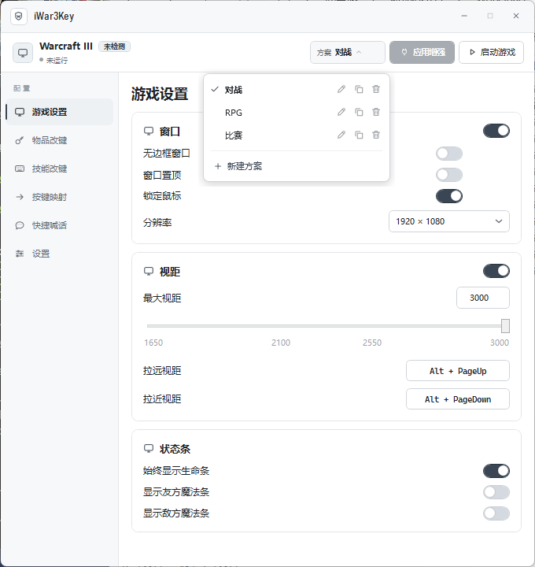
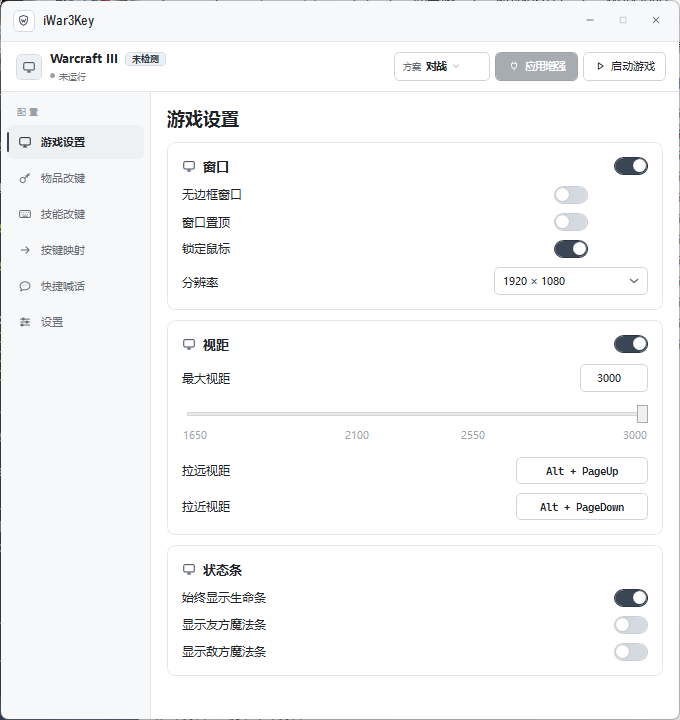
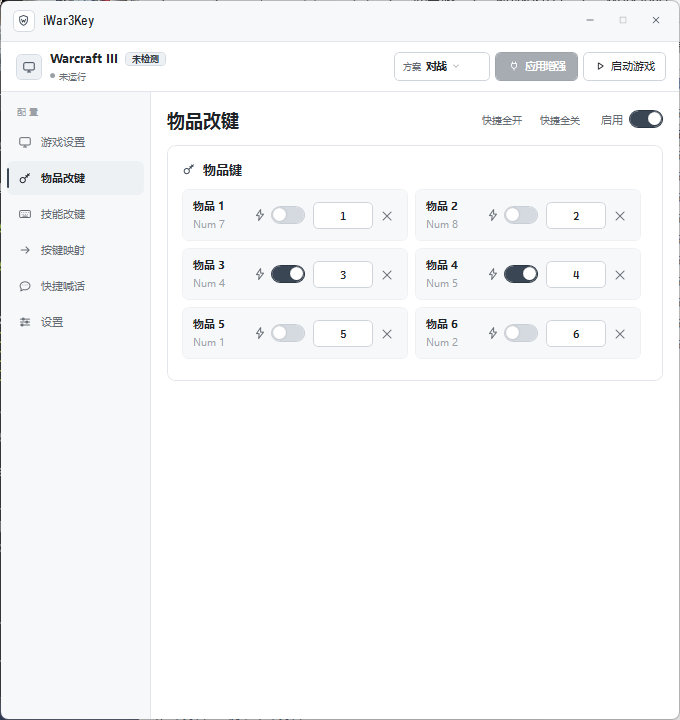
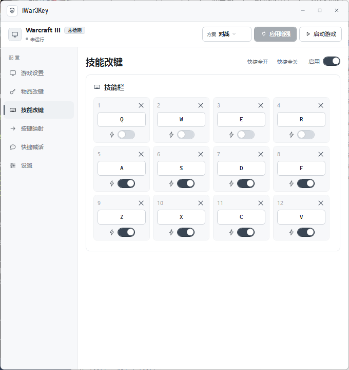
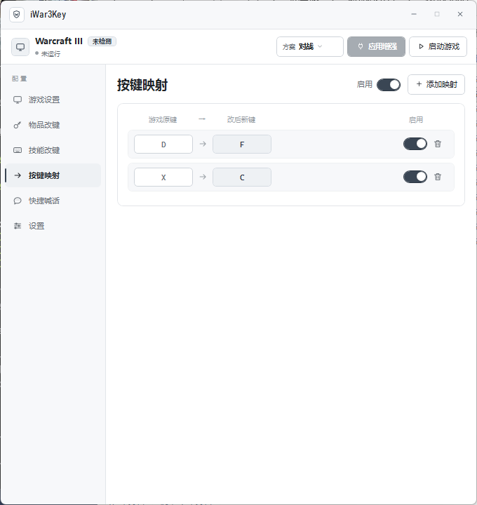
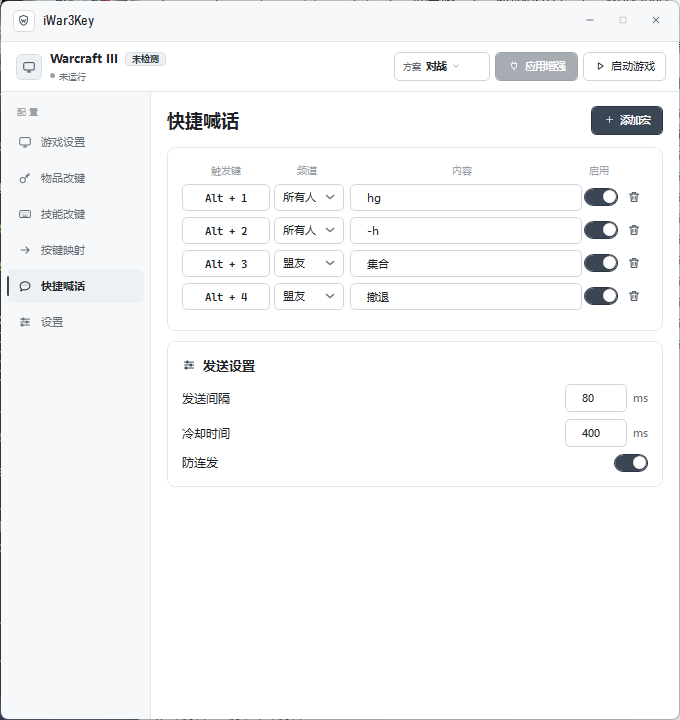
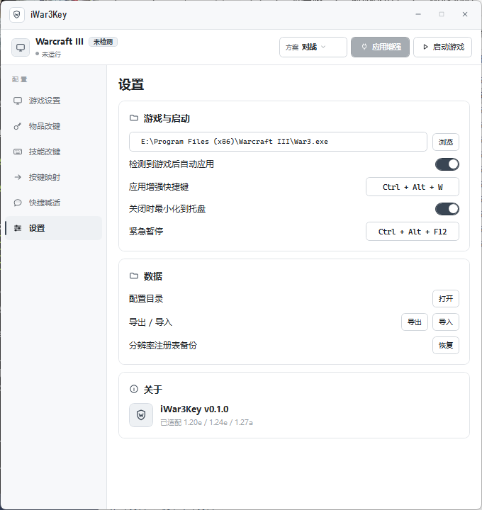

# iWar3Key

面向《魔兽争霸 III》单机 / 本地 RPG 的配置与增强工具，已适配 **1.20e / 1.24e / 1.27a**。

- 物品改键、技能改键、按键映射、快捷喊话，一套工具全部管理
- 最多 9 套方案，游戏内随时切换
- 窗口、视距、状态条增强
- 配置自动保存，不修改地图文件，不联网

## 快速开始

1. 以管理员身份运行 `iWar3Key.exe`（游戏以管理员运行时，工具也必须是管理员权限）。
2. 打开「设置」，选择 `war3.exe`；如果注册表里已有安装路径，会自动识别。
3. 在顶栏「方案」中新建或选择一套方案，按需配置物品、技能、按键映射和快捷喊话。
4. 点击「应用增强」；勾选「检测到游戏后自动应用」后，启动游戏会自动生效。
5. 进入地图后即可使用配置的按键。游戏过程中可以通过顶栏「方案」随时切换。

建议使用窗口模式运行游戏；通过工具「启动游戏」时会自动以窗口模式启动。

## 多套方案

  

- 顶栏「方案」下拉显示所有方案，当前方案带勾选。
- 每套方案独立保存：物品改键、技能改键、按键映射、快捷喊话（含发送间隔、冷却、防连发）。
- 窗口、视距、状态条、游戏路径、应用/暂停热键属于全局设置，切换方案不会改变。
- 支持新建、复制、重命名、删除；最多 9 套，最后一个方案不能删除。
- 切换立即生效；游戏已连接时不需要重新应用，也不需要重启游戏。
- 新建空白方案是干净状态；复制方案会完整保留按键、映射和宏。

## 游戏设置

  

### 窗口

- 无边框窗口、窗口置顶、锁定鼠标。
- 分辨率预设（1024×768 到 1920×1080）和自定义宽高。
- 通过工具启动游戏时会备份并设置游戏分辨率，退出后自动恢复。

### 视距

- 最大视距可在 1650–3000 之间调整。
- 游戏中可用「拉远视距 / 拉近视距」快捷键实时调整，默认 `Alt+PageUp` / `Alt+PageDown`，支持自定义，步长 100。
- 只影响当前游戏，不写入配置；关闭工具或紧急暂停不会改回原视距。

### 状态条

- 「始终显示生命条」：更清楚地看到所有单位的生命值。
- 「显示友方魔法条」「显示敌方魔法条」：在生命条下方显示魔法值；友方包含自己。
- 魔法条依赖生命条，关闭生命条时两个魔法条开关会自动关闭。
- 如果在地图已经加载后才首次应用，已有单位可能需要重新进入地图才会显示魔法条。

## 物品改键

  

- 物品 1–6 六个格子，每个格子可以单独设置按键。
- 每个物品格有独立的「快捷施法」开关，也可以一键快捷全开 / 全关。
- 快捷施法开启后，按下物品键会额外补一次左键，适合需要立即指定目标的物品。
- 支持单独清除某个物品键。

## 技能改键

  

- 按游戏命令卡 4×3 共 12 个位置绑定：顶排 1–4、中排 5–8、底排 9–12。
- 不按具体技能名绑定，换英雄或换单位后会按当前位置自动对应。
- 每个位置有独立的「快捷施法」开关，支持快捷全开 / 全关。
- 技能键支持 A–Z / 0–9 单字符键。
- 快捷施法开启后，触发技能会额外补一次左键。

## 按键映射

  

- 设置「游戏原键 → 改后新键」，例如 D → F、X → C。
- 每条映射可以单独启用或删除。
- 只在游戏前台和游戏内生效，不影响其他程序。
- 适合把不顺手的位置键换成更顺手的键。

## 快捷喊话

  

- 每套方案最多 9 条宏。
- 每条宏可设置触发键、频道（所有人 / 盟友）、喊话内容和启用状态。
- 支持中文喊话。
- 可调整发送间隔、冷却时间和防连发。
- 聊天框打开时，改键和宏会自动暂停，避免误触。

## 设置

  

- 游戏路径、检测到游戏后自动应用。
- 「应用增强」快捷键，默认 `Ctrl+Alt+W`。
- 紧急暂停快捷键，默认 `Ctrl+Alt+F12`。
- 关闭窗口时最小化到托盘；工具只运行一个实例，重复启动会提示。
- 打开配置目录、导出 / 导入配置、恢复分辨率注册表备份。

## 紧急暂停

- 默认快捷键 `Ctrl+Alt+F12`，也可以从托盘菜单操作。
- 只暂停物品改键、技能改键、按键映射和快捷喊话。
- 窗口、视距、状态条会保持当前状态，不会被关闭或恢复。
- 再次按下快捷键即可恢复改键和喊话。

## 数据与备份

- 配置会自动保存，不需要手动点保存。
- 数据目录优先使用程序目录下的 `data`；如果不可写，会使用 `%APPDATA%\iWar3Key`。
- 每次写入前会备份旧配置，最多保留 10 份。
- 「设置 → 数据」可以打开配置目录、导出 / 导入配置，或从备份恢复分辨率注册表。
- 工具不会修改地图文件，也不会联网。

## 兼容性与注意事项

- 支持 1.20e、1.24e、1.27a。
- 游戏以管理员运行时，工具必须以管理员身份运行。
- 物品改键、按键映射和快捷喊话只在游戏内界面就绪后生效；主菜单、房间和载入界面按键原样透传。
- 菜单打开或聊天框打开时，改键会自动暂停。
- 改键不会改变游戏技能 / 物品面板上显示的原生热键，只改变你实际按下的键。
- 技能改键只接受 A–Z / 0–9 单字符键。
- 方案最多 9 套；每套方案的快捷喊话最多 9 条宏。
- 未签名程序，部分杀毒软件可能提示；请自行确认使用场景。
